# How it works inside: commands, rules and the repos that do the work

One diagram of the whole repo: what each command runs, where every rule comes from and which one wins, which sibling repo does the specialist work, and where the guards run. The repo-to-repo picture (git and folders) is in the README, under "How the repos connect". The harness as a whole (its layers, back end, APIs, eval, tests and limits) is in [`harness.md`](harness.md).

```mermaid
%%{init: {"flowchart": {"wrappingWidth": 420}}}%%
flowchart TB
    classDef you fill:#1C4657,stroke:#1C4657,color:#FFFFFF
    classDef hub fill:#9CE6FF,stroke:#2C97BB,color:#1C4657
    classDef repo fill:#FFE86D,stroke:#A28E26,color:#574900
    classDef private fill:#FFC9DE,stroke:#C2507F,color:#5A1530
    classDef out fill:#B3E65F,stroke:#6E9A24,color:#2F440B
    classDef guard fill:#FFFFFF,stroke:#888888,color:#333333

    you(["You, in Claude Code"]):::you
    start["Session start: CLAUDE.md imports AGENTS.md, mental-model.md, house-rules.md<br/>config.yaml and writing-rules.yaml; repos.py status, doctor.py<br/>SessionStart hooks: preflight.py checks the harness works,<br/>load_voice.py puts the social voice guide into context"]:::hub

    subgraph cmds ["Commands in .claude/skills/, each runs one workflow in system/"]
        direction LR
        c1["/write-linkedin-article<br/>10-linkedin-articles/<br/>linkedin-article.md"]:::hub
        c2["/write-linkedin-post<br/>20-linkedin-posts/<br/>linkedin-post.md, and a post type<br/>from post-types/ when one fits"]:::hub
        c3["/write-portfolio-page<br/>30-portfolio-pages/<br/>portfolio-page.md"]:::hub
        c7["/write-blog-post<br/>35-blog-posts/<br/>blog-post.md"]:::hub
        c8["/write-text<br/>50-other-text/<br/>other-text.md"]:::hub
        c9["/add-voice-sample<br/>00-core/<br/>voice-library.md"]:::hub
        c5["/plan-visuals<br/>00-core/<br/>visual-handoff.md"]:::hub
        c6["/check-draft and /content-status<br/>both read-only"]:::hub
    end

    subgraph inputs ["Every command reads"]
    direction LR
    subgraph rules ["The rules: the first wins"]
        direction TB
        r1["First: your own rules<br/>MY_WRITING_RULES.md for writing, this repo<br/>MY_RULES.md for confidentiality, the profile repo"]:::private
        r2["Second: the hard rules, which no voice guide overrides<br/>house-rules.md sections 1 and 2, banned-phrases.txt<br/>this repo, system/00-core/"]:::hub
        r3["Third: SOCIAL_VOICE.md, TONE_OF_VOICE.md<br/>built from your own posts<br/>this repo, workspace/tone-of-voice/"]:::private
        r4["Then the defaults: the rest of house-rules.md,<br/>social-voice-rules.md for posts, the CV,<br/>cover letter and outreach rules"]:::hub
        r1 ~~~ r2 ~~~ r3 ~~~ r4
    end

    subgraph facts ["Where the facts come from"]
        direction TB
        f1["MY_PROFILE.md, GOALS.md,<br/>cv-master-actual.md, portfolio-stories/<br/>the profile repo workspace/"]:::private
        f2["The topic's own sources<br/>for example ../company-brain:<br/>README, System/, skills"]:::repo
        f1 ~~~ f2
    end
    end

    loop["system/00-core/content-loop.md, run by every writing command<br/>six stages: gather the evidence, frame the reader and takeaway,<br/>shape the draft, plan the visuals, check, then ship<br/>templates/: brief, evidence ledger, placement map"]:::hub
    check["Stage 5 and /check-draft<br/>test_check_text.py with ai_patterns.py: the words and the AI-pattern score<br/>test_check_structure.py: the loop was followed<br/>ai_review.py: the AI reviewer, an LLM-as-a-judge, when a backend can run"]:::hub

    subgraph engines ["Work in sibling repos"]
        direction LR
        e1["../design-assistant<br/>every image outside the site<br/>docs/brand.md, .claude/commands/:<br/>/visual-brief, /explainer, /card-illustration,<br/>/architecture-diagram, /one-pager, /placeholder<br/>npm run design renders the image"]:::repo
        e4["../Portfolio, design assets<br/>images for the portfolio site<br/>scripts/design-assets.mjs and its templates,<br/>docs/design-assets.md"]:::repo
        e3["../Portfolio, content<br/>AGENTS.md and the CMS fields in<br/>src/integrations/supabase/types.ts<br/>content scripts in supabase/content/"]:::repo
    end

    subgraph made ["What gets made"]
        direction LR
        o1["workspace/pieces/YYYY-MM-DD-slug/<br/>brief.md, evidence.md, draft.md,<br/>visuals.md, visuals/, final copy,<br/>feedback.md, .first/"]:::out
        o2["workspace/content-log.md<br/>idea, drafting, review, final, posted"]:::out
        o4["workspace/tone-of-voice/<br/>voice samples, rebuilt voice guide"]:::out
    end

    subgraph guards ["Guards: they run without being asked"]
        direction LR
        g1["Session hooks: protect_rules.py asks before a rule file changes;<br/>a check after every write and at every turn end, quoted chat text included;<br/>the commit check denies on errors"]:::guard
        g2["CI on every pull request: 206 tests incl. the rules lock<br/>and the feedback cases; test_check_pieces.py"]:::guard
        g3["Your corrections: tests/feedback/cases.json,<br/>rewrite pairs, house rules with HR- IDs"]:::guard
    end

    publish(["You publish: LinkedIn, your site, applications"]):::you

    you --> cmds
    start -.->|"read first"| cmds
    c1 & c2 & c3 & c7 & c8 --> loop
    c5 -->|"stage 4 on its own"| e1
    c5 -->|"site images"| e4
    c6 --> check
    c9 --> o4

    rules ==>|"rules"| loop
    facts -->|"facts for the evidence ledger"| loop

    loop -->|"stage 5"| check
    loop -->|"stage 4: brief and command"| e1
    loop -->|"stage 4, site images"| e4
    c3 -->|"reads the fields"| e3
    c7 -->|"reads the fields"| e3

    loop -->|"writes"| o1
    o1 --> o2
    e1 -->|"image into visuals/, placed by marker"| o1
    e4 -->|"image into visuals/, placed by marker"| o1
    o1 -.->|"page.md, applied in the Portfolio repo"| e3
    o4 -.->|"the voice rules learn from it"| r3

    o1 -.-> g1
    o1 -.-> g2
    g3 -.->|"tested on every run"| g2

    o1 --> publish
```

## How to read it

- **Colours:** blue is this repo, yellow is what it reads or runs in a sibling, pink is your private data (your voice files in this repo's `workspace/tone-of-voice/`, your profile, rules and CV in the profile repo), green is what gets made, white is the guards, dark is you.
- **Session start loads the context before any command.** `CLAUDE.md` imports `AGENTS.md`, the content loop and the full house rules. `config.yaml` names the sibling repos and your private files, `writing-rules.yaml` names every rule and voice file by key, and `doctor.py` checks that both resolve. Two SessionStart hooks follow: `preflight.py` checks that the hooks load and `doctor.py` passes, and says so when one fails; `load_voice.py` puts your social voice guide into context (`docs/voice.md`).
- **The thick arrow is the rules, applied in order,** as the house rules' opening paragraph sets it. Your own rules win over everything: `MY_WRITING_RULES.md` here for writing, `MY_RULES.md` in the profile repo for confidentiality. Then the hard rules, sections 1 and 2 of `house-rules.md` with the banned phrases, which apply whatever a voice guide says. Then your voice guides: `SOCIAL_VOICE.md` for posts and articles, `TONE_OF_VOICE.md` for everything. Then the remaining defaults of `house-rules.md` and the genre rules. Posts also follow `social-voice-rules.md` in full. A post type (`system/20-linkedin-posts/post-types/`) comes after all of these and before `linkedin-post.md`, and it changes a rule above it in two cases only: the length (a lower cap, with no minimum), and a rule you set for that type yourself, which the type lists under "Where it differs".
- **Every writing command runs the same loop** (`content-loop.md`): gather the evidence, frame the reader and the takeaway, shape the draft, show it with visuals, check it, ship it. The channel workflow only adds its arc and its limits. `/write-text` runs a short form of it for a comment, a reply, a bio or a message.
- **Stage 5 has three checks.** `test_check_text.py` (with `ai_patterns.py`) checks the words; `test_check_structure.py` checks that the piece folder went through the loop (a brief, a ledger, every number and link traced to it, a limits section, matching statuses); the AI reviewer (`ai_review.py`), an LLM-as-a-judge, reads what regex cannot see, on the Claude API or the Claude CLI, and is advisory until it is calibrated (`docs/guardrails.md`, part 3).
- **Images are made where they will be shown.** An image for the portfolio site (a case study image, a thumbnail, a link preview, a blog image) is made in the Portfolio repo with the site's design system and its design-assets tools; every other image is made in `../design-assistant` with its brand rules. A piece shown in both places gets one version per place, and every image lands in the piece's `visuals/`, placed by a marker in the draft.
- **Specialist work happens in the sibling's own folder.** CVs and cover letters are made by the profile repo's workflows, with the wording rules they read from this repo, and saved in its `workspace/50-applications/`. Portfolio copy is applied by the Portfolio repo's own process; this repo never writes to its database. The siblings' slash commands don't load here: the workflows read their command files and follow them.
- **Dotted arrows are hand-overs, not automatic steps:** `page.md` waits for a separate task in the Portfolio repo, and a voice sample changes the voice guide only through `/add-voice-sample`.
- **The guards run on their own.** Hooks in `.claude/settings.json` check every content file after it is written, every changed file and the quoted text of the final reply at the end of a turn, and every commit; `protect_rules.py` asks you before a rule file, a check or its tests change. CI runs the tests (the rules lock and your corrections as cases among them) and `test_check_pieces.py` on every pull request. Each correction you make is recorded (`feedback.md`), and the first version you read (`.first/`) is paired with the one you approve, so the reviewer can be measured against you. What each guard does and cannot do: `docs/guardrails.md`.
- **The voice loop:** once you have posted a piece, `/add-voice-sample mine` saves the published text as a voice sample in this repo and refreshes your social voice guide, so the third group of rules learns from it and the next piece sounds more like you.
- **Nothing is published by the session.** You post, publish and submit.
