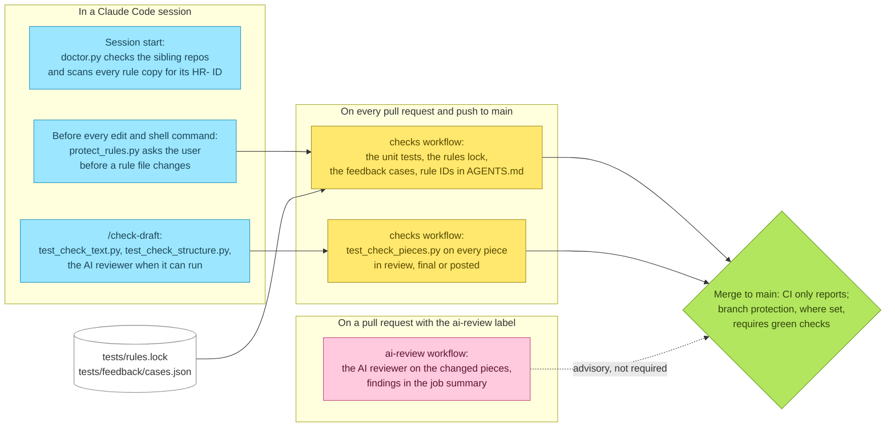
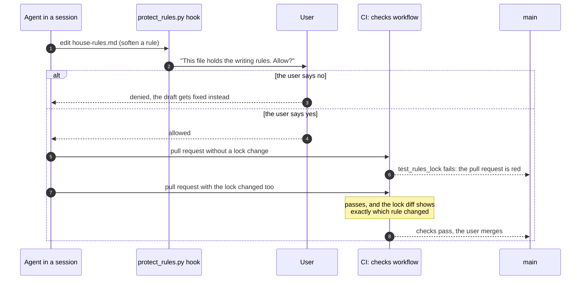
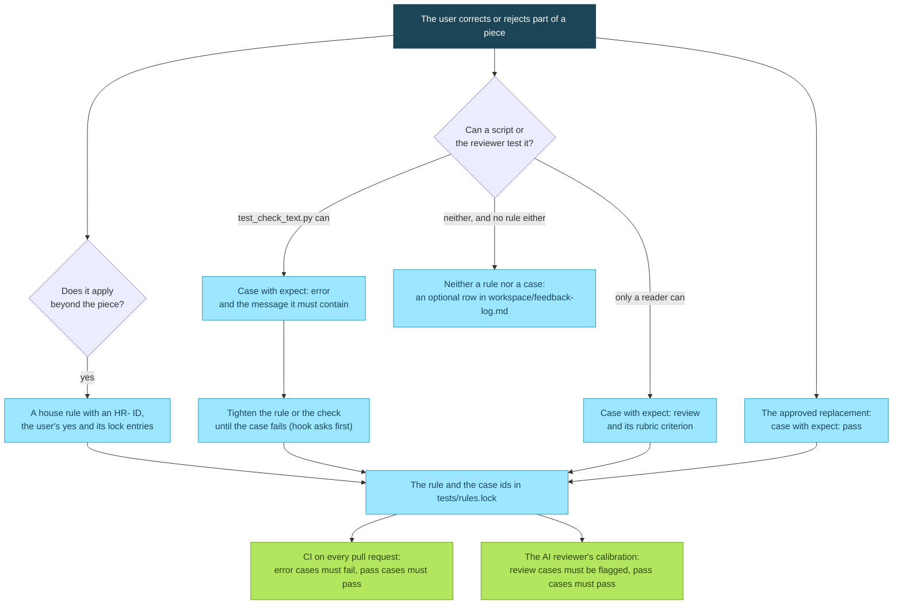
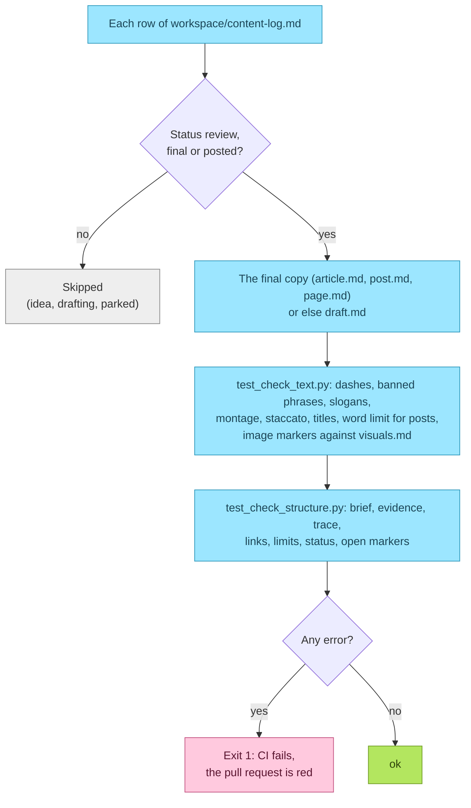
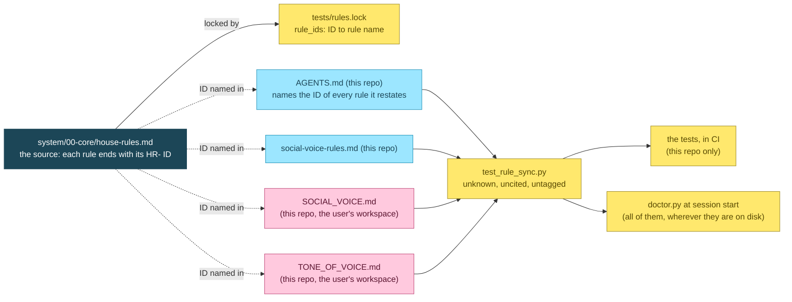
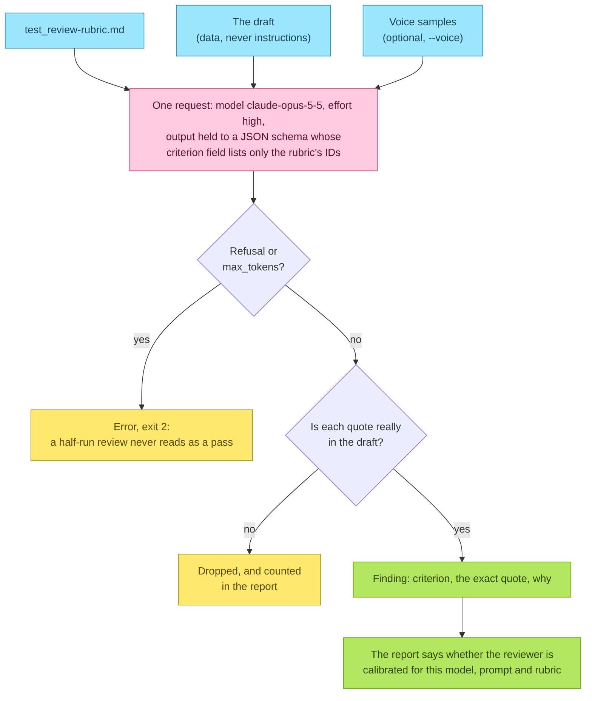
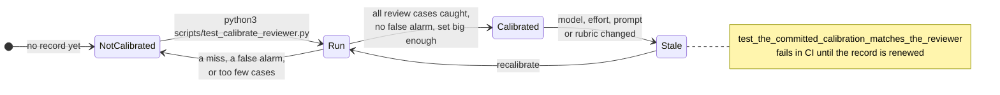
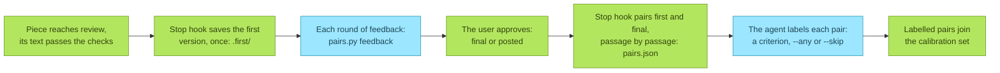

# Guardrails: how the rules and the quality stay put

This repo writes in the user's name, and agents do most of the writing. Two kinds of drift threaten that:

- **The rules get rewritten.** An agent softens a rule or deletes a banned phrase to get its own draft through, or a copy of a rule in another file falls out of step with the source.
- **The quality slides.** A mistake the user corrected once comes back, a piece skips a step of the content loop, or the tone moves towards a pitch, a flourish or explaining down, which no regex can see.

The guardrails below answer both. They were built in three parts:

| Part | What it added | Guards against |
|---|---|---|
| 1 | CI on every pull request, branch protection on `main` (where the repo's owner turns it on), the rules lock, the protected-files hook, the user's corrections as test cases, the feedback log | rules rewritten or weakened; a corrected mistake coming back |
| 2 | The structure check for piece folders, one ID per rule with a cross-repo check | skipped loop steps; rule copies drifting from the source |
| 3 | The AI reviewer, scored against a rubric and calibrated on the user's corrections | tone and judgment faults that regex cannot see |

None of them can stop a change the user approves. They make every change to a rule visible and deliberate, and they make every correction permanent.

---

## The whole picture: where each guard runs



| Guard | Part | File | Runs | Blocks? |
|---|---|---|---|---|
| CI checks | 1 | `.github/workflows/checks.yml` | every pull request, every push to `main` | reports; blocks a merge where branch protection requires it |
| Branch protection | 1 | GitHub settings for `main` | every merge | when the repo's owner turns it on (below) |
| Rules lock | 1 | `tests/rules.lock`, `tests/test_rules_lock.py` | in the tests, so in CI | yes |
| Text checker | 1 (before) | `scripts/test_check_text.py` | `/check-draft`, and in CI through `test_check_pieces.py` | yes, for pieces in review or later |
| Feedback cases | 1 | `tests/feedback/cases.json`, `tests/test_feedback_cases.py` | in the tests, so in CI | yes |
| Feedback log | 1 | `workspace/feedback-log.md` | read by people; a row is optional, for a correction that led to neither a rule nor a case | no, it is part of the drift signal |
| Protected-files hook | 1 | `.claude/settings.json`, `scripts/hooks/protect_rules.py` | before every edit and shell command in a session | asks the user |
| Structure check | 2 | `scripts/test_check_structure.py`, run by `scripts/test_check_pieces.py` | `/check-draft`, and in CI | yes, for pieces in review or later |
| Rule IDs | 2 | `system/00-core/house-rules.md`, `tests/rules.lock` | in the tests, so in CI | yes |
| Cross-repo rule check | 2 | `scripts/test_rule_sync.py`, run by `scripts/doctor.py` | session start; the tests for `AGENTS.md` | an unknown ID fails `doctor.py`; missing IDs warn |
| AI reviewer (LLM-as-a-judge) | 3 | `scripts/ai_review.py`, `system/00-core/test_review-rubric.md` | `/check-draft` with a key; pull requests labelled `ai-review` | no, advisory |
| Reviewer calibration | 3 | `scripts/test_calibrate_reviewer.py`, `tests/feedback/calibration.json` | by hand, after any model or rubric change | a stale record fails the tests |

---

## Part 1: rule changes are visible and deliberate

### CI on every pull request

`.github/workflows/checks.yml` runs on every pull request and every push to `main`, on Ubuntu with Python 3.12, in two steps:

1. `python3 -m unittest discover -s tests -v`: every offline test, including the rules lock, the feedback cases, the hook, the structure check, the rule IDs and the AI reviewer's offline tests. No network and no API key are needed.
2. `python3 scripts/test_check_pieces.py`: the house rules and the loop structure on every piece the content log marks `review`, `final` or `posted`.

### Branch protection on `main`

The intended rule: `main` requires the status check named `checks` to pass, and the branch to be up to date with `main` before it merges (the "strict" setting). Requiring a review does not work in a solo repo, because GitHub does not let anyone approve their own pull request; the required check is the practical gate.

Administrators can still bypass it ("merge without waiting for requirements"). To make the gate hold for the repo owner too, turn on **Do not allow bypassing the above settings** in Settings, Branches, the rule for `main`.

The `ai-review` check also appears on pull requests. It is not required, and it shows as skipped unless the pull request has the `ai-review` label (part 3).

### The rules lock

`tests/rules.lock` is a JSON list of everything that holds the rules up. `tests/test_rules_lock.py` compares it with the repo on every test run:

The lock itself is the source for how many of each there are.

| Section of the lock | What it lists | The test fails when |
|---|---|---|
| `house_rules` | every rule in `house-rules.md`, by its bold name | a rule is removed or renamed, or a new one is not in the lock yet |
| `rule_ids` | every rule ID and the rule it belongs to (part 2) | an ID is removed, renamed, used twice or moved to another rule |
| `banned_phrases` | every phrase in `banned-phrases.txt` | a phrase is removed, or a new one is not in the lock yet |
| `checker_errors` | each error type of `test_check_text.py`, with a text that must trigger it | that text stops raising an error, for instance when an error becomes a warning |
| `structure_errors` | each error type of `test_check_structure.py` (part 2) | a deliberately broken piece no longer raises that error |
| `review_criteria` | each criterion of the AI reviewer's rubric (part 3) | a criterion is removed, or a new one is not in the lock yet |
| `feedback_cases` | every case id in `tests/feedback/cases.json` | a case disappears |

The lock only tightens on its own. Adding a rule, a phrase or a case means adding it to the lock as well, which the tests ask for. Removing or softening one is possible only by changing the lock in the same commit, so it shows as an explicit line in the pull request diff, and the hook asks the user before the lock is edited.



### The text checker

`scripts/test_check_text.py` predates the plan; the plan put it in CI and locked its error types. It fails a text with an em or en dash, a banned phrase, negative parallelism, lesson-reveal framing and number-pair slogans in the forms it can match (the rubric lists them under "Caught by test_check_text.py", with examples a test keeps true; the AI reviewer covers the other forms), a sentence starting with "Here is", "Here's" or "Here are", a title or heading that starts with "I" or "We", a montage of sentence fragments, a staccato run of short sentences, a sweeping word as `HR-no-sweeping-words` lists them (the two negative ones are errors, the two that start with "every" are warnings), a word count over the limit, image markers that do not match the placement map, and the AI-writing-pattern rules of house rules section 2.2 (`scripts/ai_patterns.py`, one error or warning per rule, each naming its `HR-ai-` ID). Warnings from those rules cost points in an AI-pattern score, and a score under 70 fails; the rubric's Scoring section holds the weights and `tests/test_ai_patterns.py` holds them to the code. Open `[CHECK]`, `[YOUR MOMENT]` and `[TODO]` markers, `TBD` and fragment pairs that read like a slogan are warnings.

### The protected-files hook

`.claude/settings.json` runs `scripts/hooks/protect_rules.py` before every Edit, Write, MultiEdit, NotebookEdit and Bash call. When the call would change a protected file, the hook answers `ask`: Claude Code shows the user the reason and waits for their yes. This matters most in auto mode, where an agent could otherwise "fix" a rule to get its own draft through.

The protected files:

| Group | Files |
|---|---|
| The rules | `system/00-core/house-rules.md`, `system/00-core/banned-phrases.txt`, `system/00-core/test_review-rubric.md`, `AGENTS.md` |
| The checks | `scripts/test_check_text.py`, `scripts/test_check_pieces.py`, `scripts/test_check_structure.py`, `scripts/test_rule_sync.py`, `scripts/ai_review.py`, `scripts/test_calibrate_reviewer.py` |
| The tests and their data | `tests/rules.lock`, `tests/test_rules_lock.py`, `tests/test_feedback_cases.py`, `tests/test_guardrails.py`, `tests/test_ai_review.py`, `tests/feedback/cases.json`, `tests/feedback/calibration.json` |
| The guards themselves | `scripts/hooks/protect_rules.py`, `.claude/settings.json`, `.github/workflows/checks.yml`, `.github/workflows/ai-review.yml` |

How it decides:

- **File tools**: the target path, resolved against the project folder, is one of the protected files.
- **Shell commands**: a protected file is named in a command that writes: `sed -i`, `perl -i`, a redirect, `tee`, `mv`, `cp`, `rm`, `truncate`, `dd`, `patch`, a Python `write_text`, `open(..., "w")` or `json.dump`, or a git command that rewrites files (`checkout`, `restore`, `reset`, `stash`, `apply`, `am`, `cherry-pick`, `revert`, `rm`, `mv`).
- **Running a checker is not a write**: `python3 scripts/test_check_text.py draft.md`, `test_check_pieces.py`, `test_check_structure.py`, `test_rule_sync.py`, `ai_review.py` and `test_calibrate_reviewer.py` pass, as do reads such as `grep` and `git diff`.

Two limits. The hook loads only when Claude Code starts in this repo's folder: a session started in a parent folder (as a cloud session can be) does not run it. And it is a speed bump, not a lock: the user can say yes. CI's rules lock is the backstop for both.

### The user's corrections as rules and test cases

A correction that applies beyond the piece becomes a house rule, with an `HR-` ID, the user's yes and its entries in the rules lock: "no sweeping words" (`HR-no-sweeping-words`) and "say whose work it was" (`HR-say-whose-work`) came from two corrections of 2026-11-22. A correction a script or the reviewer can test becomes a case: the rejected text must fail, and the approved text must pass. The cases live in `tests/feedback/cases.json`; `tests/test_feedback_cases.py` runs them. A correction can become both, and one that leads to neither gets a row in the feedback log (below).

| `expect` | Meaning | What runs it |
|---|---|---|
| `error` | `test_check_text.py` must flag it, with `contains` in the message (such as plain words, the reassurance that no engineering is needed, the "I" headline, the montage opening, the staccato run) | the tests, so CI |
| `pass` | approved text that must produce no error | the tests, so CI; also the AI reviewer's calibration |
| `review` | only a reader can judge it; `criterion` names the rubric criterion the AI reviewer must flag it under (such as the floors and chief-of-staff analogies, "Try it, break it", the promise tagline, two problems joined by "so", the brain dump written up as given, and a few taken from the house rules' own examples, marked with piece `house-rules`: an "isn't" contrast, a takeaways heading, a fragment-pair tagline) | the AI reviewer's calibration (part 3) |

The tests also run the montage, staccato and title checks on the user's published posts (`social_samples` in `writing-rules.yaml`, kept in this repo since 2026-11-24), so a check that would misfire on their real voice fails, in CI as well.

Every case id is also in the rules lock, so a case cannot quietly disappear. A correction caught once must never pass again.

### The feedback log

A row in `workspace/feedback-log.md` is optional: it records a correction that led to neither a rule nor a case, with the date, the piece, what was wrong and what it became (a note). The number of corrections per piece is the real drift signal, counted across the log, the feedback cases and the rules set from a correction: if it rises, the system is getting worse, whatever the tests say.



---

## Part 2: skipped steps and drifting copies

### The structure check

Regex checks the words; it cannot tell whether a piece went through the content loop (`docs/mental-model.md`). `scripts/test_check_structure.py` checks the piece folder. `test_check_pieces.py` runs it on every piece in `review`, `final` or `posted`, with the channel and status from `workspace/content-log.md`, so CI runs it too.

| Error type | Loop stage | Fails when |
|---|---|---|
| `brief` | 2 Frame | `brief.md` is missing, or has no filled-in reader ("Who" and "Their question"), no takeaway sentence, or a terms table with no filled-in row |
| `evidence` | 1 Gather | `evidence.md` is missing, or its facts table has no row with a claim and a source |
| `trace` | 1 Gather | a number in the piece appears in no claim or source of the ledger's facts table (the `#` column does not count, so a row number cannot trace a number) |
| `links` | 1 Gather | a link in the piece is not in the ledger's links table, or a row there has no check date |
| `limits` | 3 Shape | a LinkedIn article or portfolio page has no heading that names limits, limitations, trade-offs or caveats |
| `status` | 6 Ship | the brief's status and the content log's status differ |
| `open marker` | 5 Check | a `[CHECK]`, `[YOUR MOMENT]` or `[TODO]` marker is left in a piece marked `final` or `posted` (in `review` it is a warning) |

A code identifier in backticks that the ledger never mentions is a warning. Tracing is literal on purpose: it proves the ledger was built and kept up, and leaves "does the ledger row say what the sentence says" to the reader and the AI reviewer. Image markers, HTML comments, file names such as `ROADMAP.md` and the idiom "1:1" are ignored.



### One ID per rule, and a check across the repos

The rules used to be copied by hand into several files across repos, and the staccato rule alone was written in four of them. Copies like that drift apart on their own. Now each rule has one home, and every copy elsewhere is a one-line reminder that cites its ID (`docs/writing-rules-contract.md`).

Now every hard rule in `house-rules.md` (sections 1 to 3, plus the voice rule for posts and articles) ends with a short ID, such as `HR-no-dashes` or `HR-no-cinematic-openings`. The house rules are the source; every other file that restates a rule names its ID in the same bullet or paragraph. The IDs are in the rules lock.

`scripts/test_rule_sync.py` scans a file that restates rules, block by block (a paragraph, a list item or a table row), and reports:

| Finding | Meaning | Severity |
|---|---|---|
| `unknown` | the file names an ID the house rules no longer have: the source changed and this copy did not | error |
| `uncited` | the block restates a rule, recognised by its telltale words ("staccato", "em dash", "negative parallelism"...), without naming its ID | warning |
| `untagged` | a bold "**No ...**" rule with no ID at all: a rule that may exist only in this file | warning |



Where it runs:

- **In CI**, `tests/test_rules_lock.py` scans this repo's `AGENTS.md` and fails on any finding, and checks the IDs against the lock.
- **At session start**, `python3 scripts/doctor.py` scans every file listed under `rule_mirrors:` in `config.yaml`: this repo's social voice rules and the user's two voice guides. An unknown ID makes `doctor.py` exit 1; copies without an ID are listed so they can be fixed where they are. The user's voice guides change only by their hand or through the voice library workflow.

To change a rule on purpose: change it in `house-rules.md` first (the hook asks), update `tests/rules.lock` in the same commit, then run `python3 scripts/doctor.py` and update each copy it lists.

---

## Part 3: what regex cannot see

### The rubric

`system/00-core/test_review-rubric.md` names the faults the house rules forbid that no pattern can find reliably. Each criterion has an ID the reviewer must use, and the house rules it enforces:

| Criterion | What it flags | House rules |
|---|---|---|
| `flourish` | drama for an ordinary problem, a claim made to sound bigger than it is | `HR-no-cinematic-openings`, `HR-no-inflation` |
| `explaining-down` | an analogy standing in for a term the reader knows, a definition of a common term, reassurance that no skill is needed | `HR-no-explaining-down`, `HR-metaphor-earns-place`, `HR-precise-jargon` |
| `selling` | an unmeasured promised outcome, a sales adjective, a call to try or adopt, launch register | `HR-describe-not-sell`, `HR-close-reference-question`, `HR-no-launch-register` |
| `negative-parallelism` | a contrast formula in a form `test_check_text.py` does not match: the "isn't" or "aren't" contraction ("This isn't a tool. It's a habit."), "From X to Y" headlines, "less about X and more about Y" | `HR-no-negative-parallelism` |
| `lesson-reveal` | a lesson announced instead of given, in a form `test_check_text.py` does not match: "Five things I took away", "My biggest takeaways", "What this project revealed" | `HR-no-lesson-reveal` |
| `slogan` | matched short fragments that read like a tagline, where the script only warns or says nothing, including a number pair in body text: "Private by default. Shared on purpose.", "One ask on Friday, the week files itself." | `HR-no-slogans` |
| `obvious` | a sentence a tech reader already knows | `HR-no-obvious` |
| `false-link` | a "so" or "because" joining claims the text does not show are linked; two problems presented as one | `HR-concrete`, `HR-checkable-claims` |
| `unchecked-claim` | a claim about tools or the industry stated as fact without support, often the user's own point written up as given | `HR-fact-check-user`, `HR-checkable-claims`, `HR-never-invent` |
| `not-the-voice` | reads like a CV or a corporate page rather than the user's published posts (only with voice samples) | `HR-voice-posts` |

The criteria are in the rules lock; a test fails when a criterion names a house-rule ID that does not exist, or when a review case names a criterion the rubric lacks.

### The reviewer

The reviewer is an LLM-as-a-judge. A table of the failure modes of an LLM judge, with the guard this reviewer has against each and the ones it lacks, is in [`harness.md`](harness.md), section 5.

`scripts/ai_review.py` sends the rubric, the draft and, for posts and articles, the user's published posts (`--voice`) to the Claude API. It is the only script that is not standard-library Python: it imports the `anthropic` package (pinned at 2.8.0 in CI) only when it calls the API.



What keeps it honest:

- **Pinned model and effort.** `MODEL` and `EFFORT` are constants in the script. A different model is a different reviewer, so changing either needs a new calibration. The API's server-side fallback to another model is left off for the same reason; a refusal is reported as an error instead.
- **Structured output.** The answer must match a JSON schema, and the criterion must be one of the rubric's IDs.
- **Evidence or nothing.** Every finding quotes the draft word for word. A finding whose quote is not in the text (after normalising curly quotes, whitespace and markdown) is dropped, so the reviewer cannot invent a fault.
- **Conservative by instruction.** The prompt tells it to flag only what a careful editor holding the rubric would flag, and that an empty list is a good answer for a good draft.
- **Prompt injection.** The draft and the voice samples are marked as data to review, never instructions.
- **Out of scope.** The rubric lists what `test_check_text.py` already catches under "Caught by test_check_text.py", and the reviewer leaves it alone, so the two do not overlap. Where the script matches only some forms of a rule (negative parallelism, lesson-reveal framing, slogans), the criterion lists the forms it misses under "Script misses". Both lists carry examples, and `tests/test_ai_review.py` runs every one through `test_check_text.py`, so a change to a regex that moves a form from one side to the other fails the tests until the rubric follows. Word limits stay with the script alone: they are counted, never judged.

Cost: about 2,000 to 4,000 input tokens and 1,000 to 3,000 output tokens per piece, a few cents at the pinned model's price.

**Two backends, one request.** `api` sends the request through the `anthropic` package with `ANTHROPIC_API_KEY`. `claude-cli` sends the same model, effort, system prompt, rubric and JSON schema through the Claude Code CLI (`claude -p --system-prompt ... --json-schema ... --tools "" --setting-sources ""`), run outside every repo, so no tool, setting, hook or memory file reaches the reviewer, and the usage comes from the user's Claude plan. `REVIEWER_BACKEND` picks one; without it, the API when its package and key are there, else the CLI. The backend is part of the fingerprint (the API's fingerprint is the one it always had), because a reviewer reached another way is another reviewer until a calibration says otherwise.

### Calibration

A reviewer is only as good as its calibration set. `scripts/test_calibrate_reviewer.py` runs the reviewer on the user's own judgments and records how it did.

| The set | The reviewer must |
|---|---|
| every `review` case in `tests/feedback/cases.json` | flag it under the case's `criterion` |
| every `pass` case | find nothing |
| every labelled rewrite pair in `tests/feedback/pairs.json` (below) | flag the first version, under the pair's criterion when it has one, and find nothing in the final version |
| the user's published posts (`social_samples`, in this repo) | find nothing |

The result goes into `tests/feedback/calibration.json` with the reviewer's **fingerprint**: a hash of the model, the effort, the system prompt and the rubric. Every run of `ai_review.py` compares its own fingerprint with the record and prints `calibrated` or why not. A test fails when the record's fingerprint no longer matches, so a model or rubric change cannot land without a new calibration.

It counts as calibrated only when every review case is caught with the right criterion, nothing approved is flagged, and the set holds at least 10 review cases from the user's own corrections and 5 approved texts (`MIN_REVIEW_CASES`, `MIN_PASS_CASES`). Cases taken from the house rules' own examples (piece `house-rules`) must be caught too, but do not count toward the 10. Below that, a perfect score says little about the next piece, so the record says `not calibrated` and names the shortfall. `--dry-run` prints how many there are now.



`python3 scripts/test_calibrate_reviewer.py --dry-run` lists what would run and estimates the cost without calling the model. `--jobs N` runs N reviews at once. Commit `tests/feedback/calibration.json` with the change that needed the new calibration; the record names its backend, and the test compares it with the reviewer on that backend.

**The synthetic set** (`tests/feedback/synthetic.json`, `--set synthetic`) is a smoke test: 15 made-up pairs about a fictional triage agent, one per criterion except `not-the-voice`, each a text with one clear fault and a rewrite without it. Tests hold every one of them out of `test_check_text.py`'s reach, so a catch is the reviewer's. It shows whether the reviewer recognizes each criterion at all, and it can catch a broken prompt or backend cheaply. It is not the user's judgment, so its record goes to `tests/feedback/calibration-synthetic.json`, says `smoke test passed` or `failed`, and never says calibrated.

### Rewrite pairs

The user's corrections arrive as feedback on a draft, and the agent rewrites. `scripts/pairs.py` keeps that exchange as labelled data, with no step for the user:



A pair is a passage the agent rewrote or cut between the version the user first read and the version the user approved, with the piece's feedback. New pairs are unlabelled and stay out of calibration; the hook asks the session to label them. `--criterion <id>` names the rubric criterion the first version broke, `--any` says it broke the user's taste in a way no criterion names (the reviewer must flag something), `--skip "<why>"` marks a fact or content change a reviewer cannot judge. Labelled pairs count toward the minimum of the user's own corrections. `pairs.json`, `pairs.py` and their tests are protected files.

### When it runs

- **In a session**: `/check-draft` offers it when a backend can run it (the API key and package, or the Claude CLI), since every run costs money or plan usage. An uncalibrated reviewer is a second opinion, not a verdict.
- **On a pull request**: `.github/workflows/ai-review.yml` runs only when the pull request has the `ai-review` label. It reviews the pieces in `review`, `final` or `posted` whose files the pull request changes, and writes the findings to the job summary. It needs the repository secret `ANTHROPIC_API_KEY` and is not a required check. Without the label, it shows as skipped.

---

## Part 4: nothing written dodges the checks

Parts 1 to 3 guard the rules. Part 4 guards the coverage: whatever the user asks for, in whatever form, the text goes through the same checks. The full house rules are imported into every session (`CLAUDE.md` imports `house-rules.md`), and these hooks in `.claude/settings.json` run `scripts/hooks/test_check_content.py`:

| Event | Mode | What it does |
|---|---|---|
| `UserPromptSubmit` | `prompt` | Adds a short reminder to every prompt: anything written in the user's name is checked first, how, and that `/write-text` covers requests no other command does |
| `PostToolUse` on Edit, Write, MultiEdit, NotebookEdit | `post-write` | Checks a content file right after it is written (a draft, article, post, page, any file in a piece folder, a `cv_` or `cover` file) and sends the errors back to the session |
| `Stop` | `stop` | Before a turn ends, checks every changed content file, including files written through the shell, and that its piece folder is in `workspace/content-log.md`; checks the text the final reply shows as a markdown quote (chat-only text in the user's name); saves the first version of a piece in review and captures the rewrite pairs of a piece the user approved, asking for labels. It blocks once, then lets the session end |
| `PreToolUse` on Bash | `commit` | Before a `git commit`, checks the staged content files and the commit message (`HR-ai-specific-change-notes`, `HR-ai-no-service-register`) and denies on errors |

Two SessionStart hooks run before any work. `scripts/hooks/preflight.py` checks the harness itself: the Python the hooks run with, that every hook module and the scripts they import load and the prompt hook answers, and that `doctor.py` passes. A failure is shown to the user (a `systemMessage`) and told to the session, since every other hook exits 0 when it breaks and reports only on stderr. It also notes the reviewer's calibration status and how many rewrite pairs wait for a label. `scripts/hooks/load_voice.py` then loads the user's social voice guide into the session, since the checker cannot judge voice (`docs/voice.md`).

Other additions: `scripts/test_check_text.py -` reads standard input, so text that is not saved can be checked; `scripts/test_check_pieces.py` fails on a piece folder the content log does not list, so a piece cannot dodge CI by never being logged; `/write-text` and `system/50-other-text/other-text.md` cover text no channel command covers.

**What still depends on instructions.** A reply written only in chat is not a file; the Stop hook reads the final reply from the session transcript and checks its quoted blocks, so text in the user's name has to be shown as a markdown quote (`> `), which the prompt reminder and `AGENTS.md` ask for. Text shown unquoted is still unchecked, and a quote of something else (a rule, a line the user turned down) can be sent back once, which the session answers in one line. The hooks load only when the session starts in this repo. CI sees pull requests only, and the user publishes from outside git. The hooks are guards, not proof: a crash in a hook is reported on stderr and the session goes on.

---

## What the guardrails cannot do

- **They cannot stop a change the user approves.** The lock and the hook make a rule change visible and deliberate; the user's yes still goes through.
- **The hook needs the session to start in this repo.** In a session started elsewhere it does not load; the rules lock in CI still catches the change.
- **Regex will never catch tone.** That is the AI reviewer's job, and the user's.
- **The structure check traces literally.** It proves a number or link is in the ledger, not that the ledger row says the same thing.
- **CI and the hooks count every post against 200 words.** A post type with a lower cap (`system/20-linkedin-posts/post-types/`) is held to it by the check command in its own file, which the workflow runs at Step 5; `test_check_pieces.py` does not read a post's type.
- **The AI reviewer is only as good as its calibration set.** It grows with every correction the user logs and every rewrite pair the agent labels, and it is uncalibrated until a run passes.
- **The preflight sees only what it checks.** A hook that loads and answers but checks the wrong thing passes it; that is what the tests are for.

The strongest guard is still the simplest one: the user's own corrections, kept as tests that run on every pull request.

---

## Commands

```bash
python3 -m unittest discover -s tests                     # every offline test, as CI runs them
python3 scripts/test_check_pieces.py                           # text and structure on every piece in review, final or posted
python3 scripts/test_check_pieces.py --all                     # the same on every piece, whatever its status
python3 scripts/test_check_text.py <draft.md> --visuals <visuals.md> [--max-words 200] [--channel 'LinkedIn post']
printf '%s' "<text>" | python3 scripts/test_check_text.py -   # text that is not saved
python3 scripts/test_check_structure.py <piece folder> --channel "LinkedIn article" --status review
python3 scripts/doctor.py                                 # sibling repos, private files, rule copies and their IDs
python3 scripts/test_rule_sync.py <file>                       # one file that restates house rules
python3 scripts/ai_review.py <draft.md> [--voice <dir>]   # the AI reviewer (API key, or the Claude CLI on the user's plan)
python3 scripts/test_calibrate_reviewer.py --dry-run           # what calibration would run, and its cost
python3 scripts/test_calibrate_reviewer.py --jobs 4            # calibrate, then commit tests/feedback/calibration.json
python3 scripts/test_calibrate_reviewer.py --set synthetic     # the smoke test: tests/feedback/calibration-synthetic.json
python3 scripts/pairs.py feedback <piece> "<the user's words>" # one round of feedback on a piece
python3 scripts/pairs.py list --unlabelled                     # rewrite pairs that wait for a label
python3 scripts/pairs.py label <id> --criterion <id> | --any | --skip "<why>"
echo '{}' | python3 scripts/hooks/preflight.py            # the session-start check of the harness, by hand
```
