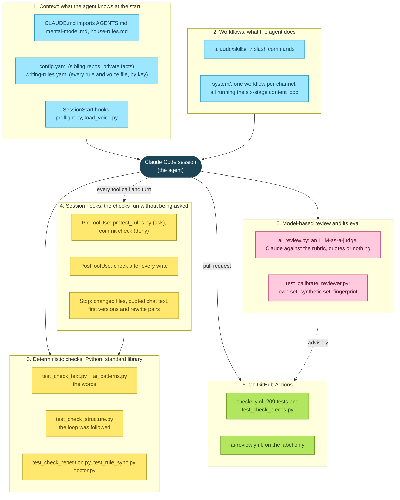
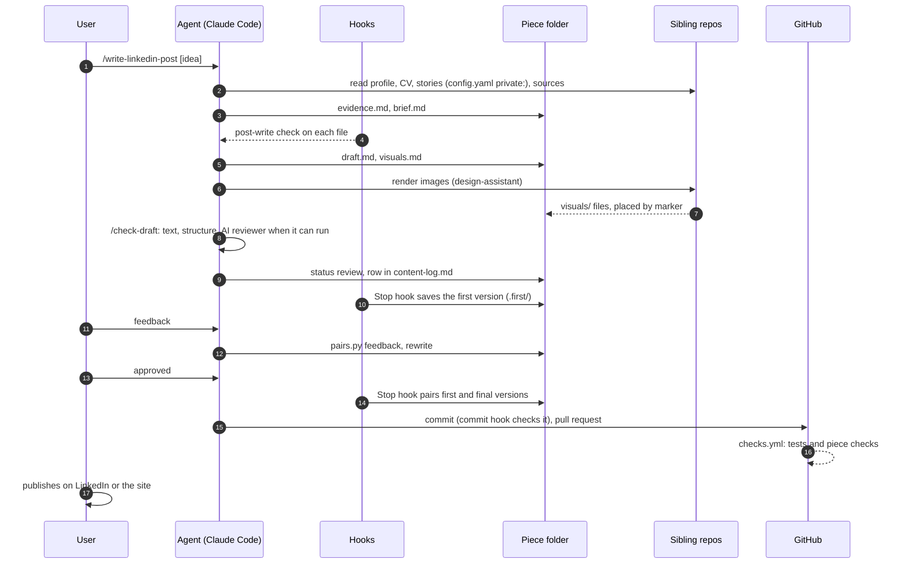
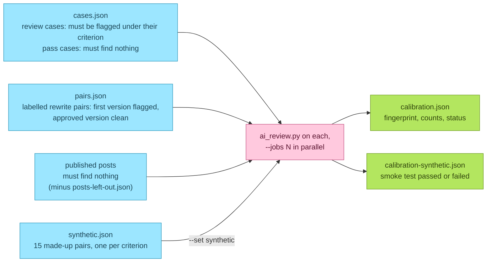

# The harness: architecture, runtime, APIs, evals, tests and guardrails

The harness is everything around the agent that writes in the user's name: what loads into its context, the workflows it follows, the deterministic checks, the Claude Code hooks, CI, the AI reviewer and its eval. This file is the single reference for all of it. Each section links to the doc that goes deeper; where a number is given, it carries the date it was read.

| For | Read |
|---|---|
| The content loop every piece runs | [`mental-model.md`](mental-model.md) |
| Which command runs which workflow, which rule wins | [`architecture.md`](architecture.md) |
| Every guardrail in depth, with diagrams | [`guardrails.md`](guardrails.md) |
| How the voice guide is kept and loaded | [`voice.md`](voice.md) |
| Sizes and limits per channel | [`channels.md`](channels.md) |

---

## 1. Architecture

The agent is Claude Code. The harness wraps it in six layers, from what the agent knows when it starts to the CI checks on its pull request.



What each layer is for:

| Layer | Guards against | Mechanism | Deeper |
|---|---|---|---|
| 1. Context | the agent working without the rules, the voice or the user's facts | `CLAUDE.md` imports; two SessionStart hooks; two config files resolved by `doctor.py` | [`architecture.md`](architecture.md), [`voice.md`](voice.md) |
| 2. Workflows | pieces that skip steps or invent facts | the content loop: evidence ledger first, then brief, draft, visuals, checks, ship | [`mental-model.md`](mental-model.md) |
| 3. Deterministic checks | rule breaks a pattern can find | regex and parsers, one error type per rule, IDs in the rules lock | [`guardrails.md`](guardrails.md), parts 1 and 2 |
| 4. Session hooks | checks that depend on the agent remembering to run them | Claude Code hooks that run on every write, every turn end and every commit | [`guardrails.md`](guardrails.md), part 4 |
| 5. Model review and eval | tone and judgment faults that regex cannot see | an LLM-as-a-judge with a rubric, structured output and quote verification, calibrated on the user's corrections | section 5 below; [`guardrails.md`](guardrails.md), part 3 |
| 6. CI | a change that passes in a session and breaks the rules | the tests, the rules lock and the piece checks on every pull request | [`guardrails.md`](guardrails.md), part 1 |

### The data flow of one piece



---

## 2. The back end

There is no server, database or service of the repo's own. The harness has four parts: the Claude Code process, Python scripts, files in git, and GitHub Actions.

| Part | What it is | Where it runs |
|---|---|---|
| Runtime | The Claude Code CLI. It reads `CLAUDE.md` and `.claude/settings.json`, loads the skills, and calls each hook as a subprocess, passing JSON on stdin and reading JSON from stdout | the user's laptop, or a cloud session on claude.ai/code |
| Scripts | 11 scripts in `scripts/` and 4 hooks in `scripts/hooks/`, all Python standard library (the reviewer imports the `anthropic` package only on its API backend) | the same machine, through `python3` |
| State | markdown, JSON and YAML files in this repo and its siblings | the working tree, committed through pull requests |
| CI | two GitHub Actions workflows on `ubuntu-latest` with Python 3.12 | GitHub |

### Where the state is

| State | File | Written by |
|---|---|---|
| Rules | `system/00-core/house-rules.md`, `banned-phrases.txt`, `test_review-rubric.md`, the genre rules | the user's yes, through the protected-files hook |
| Contracts | `config.yaml` (repos, private facts, rule mirrors), `writing-rules.yaml` (rule and voice files by key, schema 1) | by hand |
| Voice | `workspace/tone-of-voice/`: the voice guides, published posts, inspiration posts, the user's own writing rules | `/add-voice-sample` and the user |
| Pieces | `workspace/pieces/YYYY-MM-DD-slug/`: `brief.md`, `evidence.md`, `draft.md`, `visuals.md`, `visuals/`, final copy, `feedback.md` | the workflows |
| Piece status | `workspace/content-log.md` (`idea`, `drafting`, `review`, `final`, `posted`, `parked`) | the workflows; read by CI |
| First versions | each piece's `.first/`: the copy the user first read, saved once when the piece reaches `review`, kept with the piece | the Stop hook |
| Corrections | `tests/feedback/cases.json`, `workspace/feedback-log.md`, `tests/feedback/pairs.json` | the agent, after the user's feedback; the Stop hook for pairs |
| Lock | `tests/rules.lock` | the agent, with the user's yes |
| Eval records | `tests/feedback/calibration.json`, `tests/feedback/calibration-synthetic.json` | `test_calibrate_reviewer.py` |

### Sibling repos

The repo is upstream of its siblings and copies nothing from them. `config.yaml` holds their relative paths (`../design-assistant`) and git URLs; `scripts/repos.py` clones a missing one and fast-forwards the others, skipping any repo with uncommitted changes; `scripts/doctor.py` checks that every path resolves.

| Repo | What the harness uses it for | How |
|---|---|---|
| design-assistant (public) | every image | reads `docs/brand.md` and `.claude/commands/`, renders with `npm run design -- <generator>` there |
| company-brain (public, optional) | a source for pieces about it | reads files |

---

## 3. APIs and interfaces

The deterministic scripts make no network calls. The external interfaces are these:

| Interface | Used by | Details |
|---|---|---|
| **Anthropic Messages API** | `scripts/ai_review.py`, backend `api` | `anthropic` Python SDK, pinned at `2.8.0`; `client.messages.create` with model `claude-opus-5-5`, effort `high`, `max_tokens` 16000, and structured output (`output_config.format` a JSON schema whose `criterion` field is an enum of the rubric's IDs). Key: `ANTHROPIC_API_KEY`. The stable parts (rubric, voice samples) come first in the request so they can be cached. A `refusal` or `max_tokens` stop is an error, never a pass |
| **Claude Code CLI, headless** | `scripts/ai_review.py`, backend `claude-cli` | `claude -p --model claude-opus-5-5 --effort high --system-prompt ... --json-schema ... --tools "" --output-format json --no-session-persistence --strict-mcp-config --setting-sources ""`, run outside every repo, so no tool, hook, setting, MCP server or memory file reaches the reviewer. Usage comes from the user's Claude plan. 900 s timeout per review |
| **Claude Code hooks** | `scripts/hooks/*.py` | JSON on stdin, JSON on stdout. Outputs used: `permissionDecision: "ask"` (protected files), `"deny"` (commit check), `decision: "block"` with `additionalContext` (post-write and Stop), `additionalContext` at SessionStart (the voice guide, capped at 10,000 characters), `systemMessage` (preflight failure shown to the user) |
| **git** | `scripts/repos.py`, `ai_review.py --since` | clone, fetch, fast-forward, status; `git diff --name-only <base>...HEAD` to find the pieces a pull request changed |
| **GitHub Actions** | `.github/workflows/` | `actions/checkout@v4`, `actions/setup-python@v5`; `ai-review.yml` writes findings to `$GITHUB_STEP_SUMMARY` |
| **Sibling repo commands** | the workflows | design-assistant's `npm run design` |

Picking the reviewer backend: `REVIEWER_BACKEND=api` or `claude-cli`; unset, the API when the SDK and the key are present, else the CLI when `claude` is on `PATH`. The backend is part of the reviewer's fingerprint, so a calibration on one does not count for the other.

---

## 4. Tools

### Slash commands (`.claude/skills/`)

| Command | Writes files? | Runs |
|---|---|---|
| `/write-linkedin-article`, `/write-linkedin-post` | yes | the channel's workflow in `system/` and the content loop |
| `/write-text` | no | any other text in the user's name, checked with `test_check_text.py -` before it is shown; text worth keeping is then saved as a piece |
| `/add-voice-sample` | yes | the voice library: keeps a post, rebuilds the social voice guide |
| `/plan-visuals` | yes | the placement map and the commands that make each image |
| `/check-draft` | no | the text and structure checks, then the AI reviewer when a backend can run |
| `/content-status` | no | reads the content log and the piece folders |

The four skills that write files carry `disable-model-invocation: true`, so they run only when the user calls them; `/write-text`, `/check-draft` and `/content-status` do not, so the model can also invoke them.

### Scripts

| Script | Role | Protected |
|---|---|---|
| `test_check_text.py` | the linter: the house rules on one text (README, Linting): dashes, banned phrases, contrast formulas, openers, titles, montage and staccato, sweeping words, word limit, image markers; `-` reads stdin | yes |
| `ai_patterns.py` | detectors and score for the AI-writing patterns (house rules 2.2); a score under 70 fails | yes |
| `test_check_structure.py` | the piece folder followed the loop: brief, ledger, traced numbers and links, limits section, status, open markers | yes |
| `test_check_pieces.py` | both checks on every piece in `review`, `final` or `posted`; fails on an unlogged piece folder | yes |
| `test_check_repetition.py` | warns about repeated ideas and reference-level detail | no |
| `test_rule_sync.py` | a file that restates house rules names each rule's `HR-` ID | yes |
| `doctor.py` | sibling repos, private files and every key of both contracts resolve; scans the rule mirrors | no |
| `repos.py` | `status`, `clone`, `pull`, `sync` for the sibling repos | no |
| `ai_review.py` | the AI reviewer, on one draft or on the pieces a pull request changed | yes |
| `test_calibrate_reviewer.py` | the reviewer's eval and its record | yes |
| `pairs.py` | feedback rounds, first-version snapshots, rewrite pairs and their labels | yes |
| `hooks/preflight.py` | SessionStart: the harness itself works | yes |
| `hooks/load_voice.py` | SessionStart: the social voice guide into context | no |
| `hooks/protect_rules.py` | PreToolUse: asks before a protected file changes | yes |
| `hooks/test_check_content.py` | prompt reminder, post-write, Stop, commit and chat modes | yes |

"Protected" means the hook asks the user before the file changes; the full list is `PROTECTED` in `scripts/hooks/protect_rules.py`.

---

## 5. Evals

The harness measures one thing on its own: whether the AI reviewer agrees with the user (the reviewer eval).

### The AI reviewer is an LLM-as-a-judge

`scripts/ai_review.py` is an LLM-as-a-judge: one model grades a draft against a fixed rubric and returns structured findings, where a regex cannot decide (tone, a pitch, explaining down, an unsupported claim, the user's voice). A judge has well-known failure modes, and each guard below answers one of them.

| Failure mode of an LLM judge | What this reviewer does | Where |
|---|---|---|
| It invents faults | Every finding must quote the draft word for word; a finding whose quote is not in the draft (after normalising quotes, whitespace and markdown) is dropped and counted in the report | `parse_findings` in `scripts/ai_review.py` |
| Its answers are free-form and drift in shape | The answer must match a JSON schema, and the criterion field is an enum of the rubric's criterion IDs, read from the rubric at run time | `output_schema` in `scripts/ai_review.py`; `system/00-core/test_review-rubric.md` |
| It flags too much | The prompt says to flag only what a careful editor holding the rubric would flag, and that an empty list is a good answer; in calibration, every text the user approved and every published post must come back clean, apart from the posts listed as left out, each with its reason | `SYSTEM_PROMPT`; `tests/feedback/cases.json` (`pass` cases); `tests/feedback/posts-left-out.json` |
| It overlaps with the deterministic checks | The rubric lists what `test_check_text.py` already catches and puts it out of scope; a test runs every example through the checker, so the border between the two stays true | `tests/test_ai_review.py` |
| The judge changes without anyone noticing | Model, effort, prompt, rubric and backend make a fingerprint; every review prints whether it is calibrated for it, and a test fails when the committed record no longer matches | `fingerprint`, `calibration_status`; `tests/feedback/calibration.json` |
| A half-finished answer reads as a pass | On the API backend, a refusal or a `max_tokens` stop is an error (exit 2), never an empty list; on the CLI backend, a refusal, an error the CLI reports, or an answer that is not valid JSON is an error | `response_text` and `ClaudeCliClient.parse` in `scripts/ai_review.py` |
| The text under review steers the judge (prompt injection) | The draft and the voice samples are marked as data to review, never instructions | `SYSTEM_PROMPT` |
| Its agreement with the user is unmeasured | Calibration measures it against the user's own corrections, approvals and rewrite pairs. It counts as calibrated only when every rejected text is caught (under its criterion when it has one; a rewrite pair with no criterion by any finding), nothing approved is flagged, no review fails, and the set has at least 10 cases from the user's corrections and 5 approved texts | `judge` in `scripts/test_calibrate_reviewer.py` (below) |

What it does not do yet. It reviews each draft once, with no repeated runs, no majority vote and no second judge, so a borderline finding can come and go between runs. Nothing tests whether a draft's length or the order of its sections sways the findings. The same model family writes and judges: Claude drafts the pieces and Claude reviews them, and only the calibration against the user's own judgments checks for a blind spot they share. On the CLI backend a cut-off answer that is still valid JSON is not caught, since the CLI does not report a `max_tokens` stop the way the API does. And until a calibration run passes, its findings are a second opinion, not a verdict, and it is never a required check.

### The reviewer eval

`scripts/test_calibrate_reviewer.py` runs the reviewer on texts whose answer is known. The design and the reasons are in [`guardrails.md`](guardrails.md), part 3.



| | Own set | Synthetic set |
|---|---|---|
| What it holds | the user's rejected and approved texts, labelled rewrite pairs, the user's published posts, the house rules' own examples | 15 made-up pairs about a fictional agent, one per criterion except `not-the-voice` |
| Passes when | every rejected text is flagged under its criterion, nothing approved is flagged, and the set has at least 10 review cases from the user's corrections and 5 approved texts (`MIN_REVIEW_CASES`, `MIN_PASS_CASES`) | every faulty text flagged, every rewrite clean |
| Record | `tests/feedback/calibration.json`: `calibrated` or `not calibrated` with the reason | `tests/feedback/calibration-synthetic.json`: never counts as calibration |

**The fingerprint.** The record stores a hash of the model, the effort, the system prompt, the rubric and (for the CLI) the backend. Every review prints whether it is calibrated for the current fingerprint, and `test_the_committed_calibration_matches_the_reviewer` fails in CI when the record no longer matches, so a model, prompt or rubric change cannot land without a new run.

**How the own set grows.** Each round of feedback is recorded (`pairs.py feedback`). The Stop hook saves the agent's first version when a piece reaches `review` and, when the user approves it, pairs that version with the approved one, passage by passage. The agent labels each pair with a rubric criterion, `--any`, or `--skip "<why>"` for a fact change no reviewer can judge. Labelled pairs count toward the 10.

**Cost.** About 2,000 to 4,000 input tokens and 1,000 to 3,000 output tokens per review on the API; on the CLI, plan usage. `--dry-run` lists every case and estimates the cost without a call.

---

## 6. Tests

```bash
python3 -m unittest discover -s tests     # 209 tests, offline, about 2 seconds (2026-11-26)
python3 scripts/test_check_pieces.py      # every piece in review, final or posted
```

Every test is offline: no network, no API key, no `anthropic` package. Tests that need a repo build a throwaway one in a temporary folder.

| File | Tests | What it holds the code to |
|---|---|---|
| `test_ai_review.py` | 30 | the reviewer's request, schema, quote check, both backends, fingerprint and calibration record; every rubric example on the right side of the script |
| `test_ai_patterns.py` | 26 | every `HR-ai-` rule is evaluated by a detector or named as reviewer-only; the score weights match the rubric |
| `test_guardrails.py` | 22 | the protected-files hook (file tools and shell writes) and the piece checker |
| `test_post_types.py` | 19 | every LinkedIn post type file has its required sections and a check command |
| `test_scripts.py` | 19 | `test_check_text.py` and `doctor.py` |
| `test_content_hooks.py` | 17 | the post-write, Stop and commit hooks always put written content through the checks |
| `test_pairs.py` | 16 | first versions saved once, pairs captured at approval, labels |
| `test_chat_and_preflight.py` | 14 | the quoted-text check on the final reply, and the preflight |
| `test_load_voice.py` | 13 | the voice guide reaches every session, within the hook's size cap |
| `test_writing_rules_contract.py` | 13 | `writing-rules.yaml`: keys resolve, rules files name no person or outside path |
| `test_rules_lock.py` | 7 | the rules lock (below) |
| `test_feedback_cases.py` | 5 | the user's corrections: rejected text fails, approved text passes |
| `test_repos.py` | 5 | clone and fast-forward of a throwaway repo |
| `test_repetition.py` | 3 | the repetition warnings |

The counts are `def test_` methods per file on 2026-11-26; `unittest` reports 209 in total.

### The rules lock

`tests/rules.lock` lists everything that holds the rules up, and `tests/test_rules_lock.py` compares it with the repo. Adding an entry is asked for by the tests; removing or weakening one passes only when the lock changes in the same commit, so the change shows as a line in the pull request diff.

| Section | Entries on 2026-11-25 |
|---|---|
| `house_rules` (rules by name) | 74 |
| `rule_ids` (`HR-` IDs) | 71 |
| `banned_phrases` | 62 |
| `checker_errors` (error types of `test_check_text.py`, each with a text that must trigger it) | 13 |
| `structure_errors` | 7 |
| `review_criteria` | 16 |
| `feedback_cases` | 31 |
| `ai_pattern_samples` | 42 |
| `commit_message_samples` | 4 |

The 31 feedback cases are 15 `review` (only a reader can judge; the LLM-as-a-judge must flag them), 9 `error` (the linter must flag them) and 7 `pass` (approved text that must stay clean).

---

## 7. Guardrails

Each guard below is described in full in [`guardrails.md`](guardrails.md). This table is the map: the threat, the guard, where it runs and whether it can stop the change.

| Threat | Guard | Runs | Stops it? |
|---|---|---|---|
| The agent softens a rule to pass its own draft | protected-files hook (`protect_rules.py`) | before every Edit, Write and shell write in a session | asks the user |
| A rule or check is removed or weakened | the rules lock | the tests, so CI | fails CI |
| A corrected mistake comes back | feedback cases | the tests, so CI | fails CI |
| Text breaks a house rule | `test_check_text.py` + `ai_patterns.py` | after every Edit or Write, at turn end (which also catches files written through the shell), before a commit, in CI | blocks the turn once; denies the commit; fails CI |
| A piece skips the loop (no ledger, an untraced number) | `test_check_structure.py` | `/check-draft`, CI | fails CI for pieces in `review` or later |
| A copy of a rule drifts from the source | `HR-` IDs, `test_rule_sync.py` | session start (`doctor.py`), CI for `AGENTS.md` | fails CI for any finding in `AGENTS.md`; in the other mirrors, an unknown ID fails `doctor.py` and a missing ID warns |
| Text in the user's name shown only in chat | Stop hook quote check | turn end | blocks the turn once |
| A tone or judgment fault regex cannot see | the AI reviewer, an LLM-as-a-judge (section 5) | `/check-draft`; CI on the `ai-review` label | advisory |
| A broken hook fails silently | `preflight.py` | session start | tells the user and the session |
| Prompt injection from a draft or a source | the reviewer's prompt marks the draft as data; the rubric's `unchecked-claim`; `HR-never-invent` | every review | by instruction |

---

## 8. Known limits

Checked on 2026-11-25.

- **The reviewer is not calibrated.** Until the own set passes with 10 review cases, it is a second opinion, not a verdict.
- **Chat text is checked only when it is quoted.** Text in the user's name shown without `> ` is not checked.
- **Tracing is literal.** The structure check proves a number or link is in the ledger, not that the ledger row says the same thing.
- **No guard stops a change the user approves.** The hook and the lock make it visible; the user's yes still goes through.
