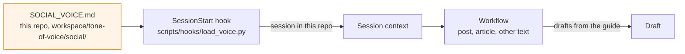

# How the user's voice is kept

How text written in the user's name comes to sound like them: where the voice is described, how that description reaches every session, how a draft is checked against it, and how the user's corrections change it. The rule behind all of it is `HR-voice-guide-first` in `system/00-core/house-rules.md`. Set up 2026-11-24, after a line for a post scored 100 on `test_check_text.py` and still read as AI to the user, because the session had run the checker and skipped the guide. Since the same day every writing rule and voice file is in this repo, under the keys of `writing-rules.yaml` (`docs/writing-rules-contract.md`).

## The short version

- **One description of the voice:** the social voice guide, `workspace/tone-of-voice/social/SOCIAL_VOICE.md` in this repo (`social_voice` in `writing-rules.yaml`). Every other file points to it; none restates it.
- **Loaded at session start.** A SessionStart hook puts the guide into context in every session started here, and the repo's `CLAUDE.md` imports the house rules.
- **The published posts are the guide's source material, not reading for each piece.** They are read when the guide is rebuilt, and by the AI reviewer.
- **The guide shows the voice by example:** its section of lines the user picked and turned down is where a correction lands, and what a draft is matched against.
- **The checker guards the hard rules, not the voice.** A score of 100 means no banned pattern; whether it sounds like the user is a read against the guide.

## Where each part is kept

Every file below is in this repo. The voice files are in the private workspace and never leave it.

| What | File (key) | Changed by |
|---|---|---|
| How the user writes posts, articles and other social text: who they write for, openings, sound, words, closes, their lines picked and turned down | `workspace/tone-of-voice/social/SOCIAL_VOICE.md` (`social_voice`) | "Build or refresh the social voice guide" in `system/00-core/voice-library.md` ("Refresh my social voice"), and the user by hand |
| The source material the guide is built from | the user's posts in `workspace/tone-of-voice/social/` (`social_samples`), others' posts in `workspace/tone-of-voice/social-inspiration/` (`social_inspiration`) | `/add-voice-sample` |
| The rules for every social post (structure, defaults, self-check) | `system/00-core/social-voice-rules.md` (`social_voice_rules`) | the user, as a rule change; it names the ID of every house rule it restates |
| The user's general tone of voice, for every kind of text | `workspace/tone-of-voice/TONE_OF_VOICE.md` (`tone_of_voice`) | the user |
| The user's own writing rules, the 200-word cap and one real detail per post among them | `workspace/tone-of-voice/MY_WRITING_RULES.md` (`writing_overrides`) | the user |
| The wording of a CV, a cover letter and an outreach message | `system/40-job-applications/cv-rules.md`, `cover-letter-rules.md`, `outreach-rules.md` | the user, as a rule change |
| Hard rules for every channel, each with an `HR-` ID | `system/00-core/house-rules.md` (`house_rules`) | the user's yes; protected and locked |

The user's confidentiality notes and facts are in `MY_RULES.md` and `MY_PROFILE.md`, where `config.yaml` points (`private:`).

Precedence, as the house rules' opening paragraph states it: the user's own rules first (`{writing_overrides}` for writing, `MY_RULES.md` for confidentiality), then the hard rules of house rules sections 1 and 2, which apply whatever a voice guide says (no dashes, `HR-no-dashes`; no slogans, `HR-no-slogans`; a banned phrase included), then the voice guides, then the remaining defaults.

## How the guide reaches a draft

**A session started in this repo.** `.claude/settings.json` runs `scripts/hooks/load_voice.py` on every SessionStart event (startup, resume, clear and compaction). It finds the guide through `writing-rules.yaml`, inside the repo, so it works the same in any clone or worktree. It adds the guide to the context with a header that names the rule, says which kinds of text it governs (not CVs or cover letters, which have their own wording rules) and that the user's own rules and the hard rules win over it. Claude Code caps the text one hook can add at 10,000 characters. Past the cap the session gets a preview of the first 2,000 characters and a file path it is not told to read, so the hook measures its finished output, header included, and keeps it under 9,900. The guide is longer than that (about 15,600 characters on 2026-11-24, after that day's refresh), so two kinds of section are left out, and the header names both:

- **Always left out:** "Images" and "Techniques I borrow", the two sections only a full post or article needs while drafting. The post and article workflows read them from the file.
- **Cut for size:** when the rest still does not fit, whole sections are cut in file order, and a later, shorter section that fits is kept. The header tells the session to read the cut sections from the file before writing anything in the user's voice, even one line. On 2026-11-24 one section is cut this way: "My tone of voice, in a post".

A guide that is missing, empty or unreadable is reported in the context, never skipped in silence; the report says how a guide that was never built gets built.

**In the workflows.** Each workflow names the guide once and no samples: `linkedin-post.md` step 1.2 and `linkedin-article.md` step 1.1 read it in full, Images and Techniques included; `other-text.md` step 1.3 drafts from the copy in context, or reads the file when there is none. `AGENTS.md` (session start, step 3) says the guide is already in context and what to do when it is not.

## How a draft is checked

| Check | What it sees | When |
|---|---|---|
| `scripts/test_check_text.py` | Hard rules and AI patterns: dashes, banned phrases, slogans, staccato runs (`HR-no-dashes`, `HR-no-stock-phrasing`, `HR-no-slogans`, `HR-no-cinematic-openings`), the AI-pattern score | Before any text is shown; hooks run it on saved files |
| The self-check, house rules section 6 | A read against the guide's lines the user picked and turned down | Before a draft is shown |
| The AI reviewer, `scripts/ai_review.py --voice <social_samples>` | The `not-the-voice` criterion, against the user's published posts | Only when asked; it needs an API key and costs money |

The checker cannot judge voice: the line the user turned down on 2026-11-24 had no error and a score of 100. That is why the voice check is a read against examples, and why the examples are in the guide, where every session has them. The checks never run on the voice library itself, `workspace/tone-of-voice/`: the posts there are kept exactly as the user published them, dashes included.

## How a correction changes the voice

When the user picks one line over another, or turns one down as not sounding like them:

1. The pair goes into the guide's section of lines picked and turned down, with the date and what makes the difference. This is the one place a voice correction is written down. A guide refresh keeps it: the refresh step of `system/00-core/voice-library.md` copies that section over as it is, and the guide's template names it.
2. A picked line becomes a `pass` case in `tests/feedback/cases.json` and its ID goes into `tests/rules.lock`, so a later rule cannot start flagging it. A phrase the user later retires is the exception: the case keeps the rest of the line. The line picked on 2026-11-24 lost its second sentence that way, after the user retired its opening phrase the same day (now in `banned-phrases.txt`).
3. A correction that applies beyond the piece becomes a house rule, with an `HR-` ID, a lock entry and the user's yes; one a script or the reviewer can test becomes a case. A row in `workspace/feedback-log.md` is only for a correction that led to neither.

A turned-down line does not become a `review` case while calibration runs without voice samples (see below). Nothing about the voice is copied into the user's global `CLAUDE.md` or into Claude's memory beyond a pointer to the guide. Copies drift, and a copy that differs from the guide is a second voice.

## Why it works this way

- **One source per concern.** The voice is in the guide; hard prohibitions are in the house rules, where a script can enforce them; the user's own writing rules are in `MY_WRITING_RULES.md`. A restated rule names its ID so `doctor.py` can find copies that drift. Before this change the same voice instruction was in four files, each worded differently ("every sample", "a few samples", "the guide and every sample").
- **A distilled guide over raw posts.** The guide is the posts, already analysed: openings, sound, words, structure, with quoted evidence. Reading every post for each piece costs context, grows with every post added, and invites copying their phrases. The posts stay the guide's source, used when it is rebuilt.
- **Loaded at one fixed point.** An instruction inside a workflow step depends on the step being read and followed; the 2026-11-24 miss was a skipped step. A hook runs whatever the request, and the session start is the one step every session goes through.
- **Examples over adjectives.** "Conversational" and "plain" let a polished sentence pass a self-check. A line the user turned down, next to the one they picked, shows the difference the adjectives leave open.

## Known gaps

- **The guide has outgrown one hook.** The hook has room for about 8,900 characters of guide, and the guide without "Images" and "Techniques I borrow" is about 11,200 (2026-11-24). Each refresh that makes the guide longer cuts another section from the session-start copy, the later sections first. The header names them and says to read them, and that is an instruction a session can skip, which the hook was built to avoid. Two ways to close the gap, both waiting for the user's yes: a shorter guide, or a second SessionStart entry that loads the rest. The second needs a test session first, to confirm that Claude Code measures each hook's output on its own, and it changes `.claude/settings.json`, which is protected.
- **The AI reviewer compares with the posts, not the guide**, and calibration (`scripts/test_calibrate_reviewer.py`) gives it no voice samples, so `not-the-voice` is never calibrated and a turned-down line cannot become a `review` case. The next step is to give the reviewer the guide as its voice reference and calibrate `not-the-voice` on the turned-down lines. It changes protected files and needs a paid calibration run, so it waits for the user's yes.
- **`scripts/hooks/load_voice.py` is not a protected file.** `tests/test_load_voice.py` fails if the hook is unwired from `.claude/settings.json`, which is protected; adding the script to `PROTECTED` in `scripts/hooks/protect_rules.py` would guard it the same way as the checkers.
